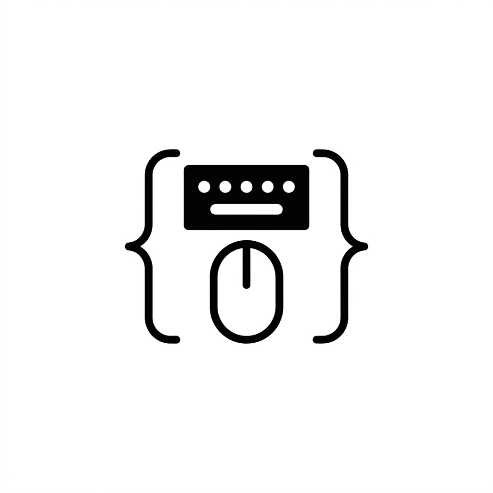

<p align="center">
  
</p>

# Context Daemon (`contextd`)

[](LICENSE.md)

A generic, lightweight Linux daemon that exposes process context (e.g., gaming activity), hardware inventory, and system ambient lighting context via Varlink interfaces.

## Purpose

`contextd` allows userspace applications to:
1. **Detect active sessions**: Seamlessly identify when a high-performance app or game starts or stops across multiple launchers.
2. **Hardware Inventory**: List connected peripherals (keyboards, mice, controllers) and check their access permissions (`uaccess`).
3. **IPC Ambient Lighting Bridge**: Lets user-level apps and hardware micro-daemons (like `argbd` or OpenRGB bridges) publish and consume an ambient lighting "vibe". Anyone can read it; writing is limited to the `contextd-rgb` group.

## Workspace Architecture

```
contextd/
├── src/                            # contextd Core System & RGB Daemon
├── contextd-client/                # Official Rust Client Library (contextd-client)
│   └── interfaces/                 # Varlink interface definitions (source of truth)
├── helpers/
│   └── contextd-focus/             # Session helper: reports the focused window
└── bridges/
    └── openrgb-contextd-bridge/    # Optional OpenRGB SDK TCP Bridge (Port 6742)
```

### Components

- **`contextd`**: Core daemon serving game detection, hardware inventory, and RGB observer/control Varlink sockets.
- **`contextd-client`**: Official Rust client crate providing type-safe interfaces (`CoreClient`, `ObserverClient`, `ControlClient`) with automatic reconnection. The daemon is built on the same generated types.
- **`contextd-focus`**: Runs in each user's graphical session (systemd user service) and tells `contextd` which process owns the focused window, so `GetActiveGame` returns the game you are actually looking at. Supports X11/XWayland (KDE, GNOME, any X11 desktop), Hyprland and Sway.
- **`openrgb-contextd-bridge`**: Optional TCP server bridge on port 6742 that accepts OpenRGB SDK RGB updates and forwards them to `contextd`.

## Features

- **Wide Launcher Support**: Detects installed and running games from Steam (Native/Flatpak, including non-Steam shortcuts), Heroic Games Launcher (Epic, GOG, Amazon), Lutris, Bottles and itch.io.
- **Focus-Aware**: With `contextd-focus` running, the active game is the one whose window has focus, not just the last one launched.
- **Push Updates**: `SubscribeRunningGames` and `SubscribeDevices` stream changes as they happen; nothing runs in the background unless someone is subscribed.
- **Hardware-Aware**: Groups udev nodes by physical device (so two identical controllers stay two devices) and lists every node of each device. Devices that OpenRGB supports (from its installed udev rules) are marked `rgb`.
- **Compact Lighting Frames**: The lighting matrix can travel as base64 RGBA (`packed_matrix`), about 6× smaller than the JSON array form.
- **System Diagnostics**: Reports RAM, CPU, GPU specs, kernel version, and verifies Vulkan and OpenGL libraries.
- **Modern IPC**: Uses [Varlink](https://varlink.org/) over Unix sockets (`/run/contextd/public/contextd.socket`, `/run/contextd/public/contextd-rgb-observer.socket` and `/run/contextd/private/contextd-rgb-control.socket`).
- **systemd Native**: Distributed as a **systemd portable service** (`portablectl`) with socket activation: the daemons start when a client first connects.

## Installation & Deployment (systemd portablectl)

### Universal Deployment
Run the production deployment script to assemble the portable OS tree in `/opt/contextd`, create the `contextd-rgb` group, install the OpenRGB bridge, and attach and enable the service with `portablectl`:
```bash
./scripts/deploy.sh
```
`portablectl` comes from the `systemd-container` package on Debian, Ubuntu and Fedora, and with `systemd` on Arch.

To let a user change lighting:
```bash
sudo usermod -aG contextd-rgb "$USER"   # log in again afterwards
```

### Focus Helper
Packages enable `contextd-focus` for every user's graphical session; it starts at your next login. To start it now:
```bash
systemctl --user start contextd-focus.service
```
KDE and GNOME pass `DISPLAY` to user services. On Sway or Hyprland, export the session variables once at startup, e.g. `exec dbus-update-activation-environment --systemd --all` in your compositor config. Check what it sees with `contextd-focus --once`.

On KDE and GNOME Wayland the helper sees XWayland windows, which is where Proton and most native games run; native Wayland windows count as "nothing focused".

### Optional OpenRGB SDK Bridge Service
To start the optional OpenRGB SDK bridge daemon on TCP port 6742 (127.0.0.1 only):
```bash
sudo systemctl enable --now openrgb-contextd-bridge.service
```
OpenRGB's own SDK server uses the same port; set `OPENRGB_SERVER_PORT` in the unit if you run both.

### Interaction
Use the `contextctl` helper to query the daemon:
```bash
# Get the focused game (or the most recently launched one)
./scripts/contextctl.sh active

# List all running games (focused one first)
./scripts/contextctl.sh running

# Stream running games / devices as they change
./scripts/contextctl.sh watch-games
./scripts/contextctl.sh watch-devices

# List installed games
./scripts/contextctl.sh list-games

# List connected gaming peripherals
./scripts/contextctl.sh list-devices

# List devices with RGB lighting (as known to OpenRGB's udev rules)
./scripts/contextctl.sh list-rgb

# Get system diagnostics
./scripts/contextctl.sh diagnostics
```

## Security & Access Control

- **Public sockets**: The core socket and the lighting observer socket are readable by everyone.
- **Restricted control socket**: `/run/contextd/private/contextd-rgb-control.socket` is mode 0660, group `contextd-rgb`. `auth.authorized_units` can narrow it to specific system services.
- **Peer validation**: `SO_PEERCRED` (and `SO_PEERPIDFD` where available) identifies callers: controller hints are bound to the caller's own processes, and only system-slice units can match the whitelist.
- **Limits**: Connections per user, message sizes and idle time are capped, so one local user cannot starve the daemon.
- **Fail closed**: A config file that exists but does not parse stops the daemon instead of falling back to defaults.

See [docs/security.md](docs/security.md) for details.

## Development & Verification

Build and run CI tests across the workspace:
```bash
cargo fmt --all -- --check
cargo clippy --workspace --all-targets -- -D warnings
cargo test --workspace
```

Run a development instance without root or systemd; sockets go under the runtime directory:
```bash
cargo run -- --runtime-dir /tmp/contextd --config examples/config.sample.toml
cargo run -- --rgb --runtime-dir /tmp/contextd
```

## License

MIT
