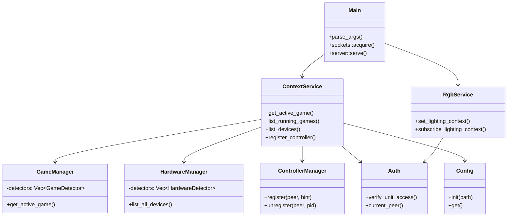
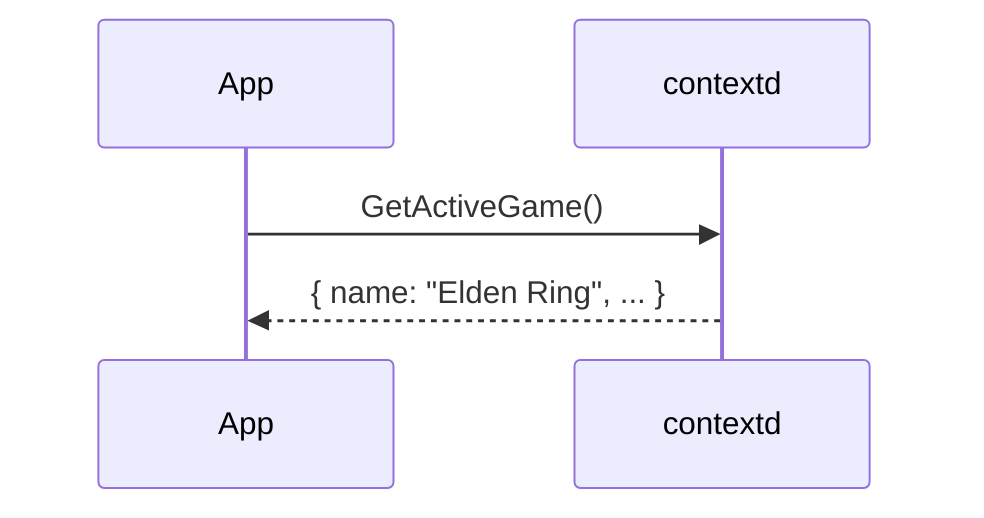
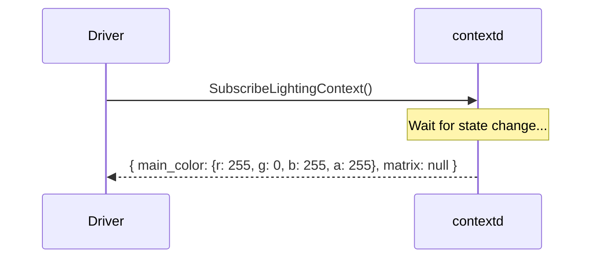
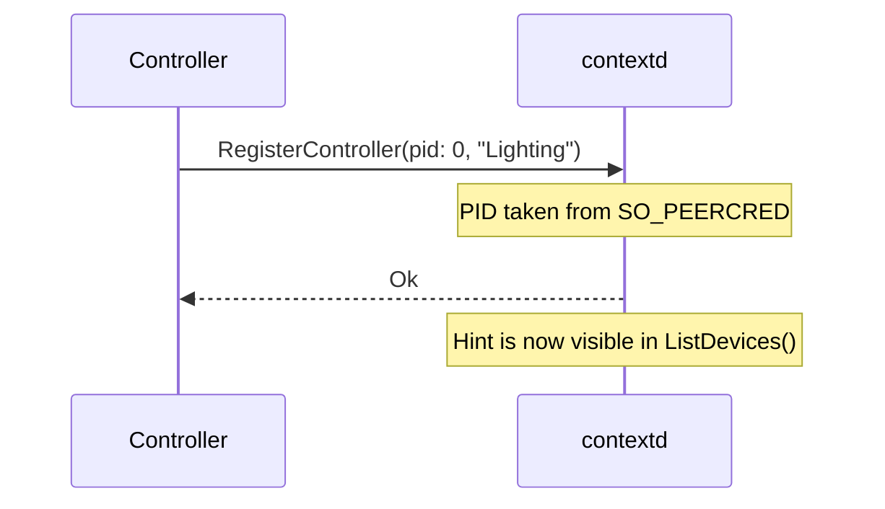

# System Architecture

This document explains the internal design of `contextd` and how external applications interact with the system.

## 🏗️ High-Level Structure

`contextd` follows a "dumb daemon, smart client" philosophy. It acts as a central hub that collects system state and exposes it via a typed interface.

### Key Components:
1.  **Detectors**: Pluggable modules that gather data from various sources:
    *   **Game Detectors**: Read Steam, Lutris, and Heroic libraries, and recognise running games by the environment variables each launcher sets.
    *   **Hardware Detector**: Uses `udev` to discover gaming peripherals, group their nodes by physical device, and verify `uaccess`.
    *   **Diagnostics**: Gathers system specs (CPU, GPU, RAM) and library support.
2.  **Managers**: Handle caching, TTLs, and data aggregation for each category.
3.  **Varlink Service**: The primary communication layer, exposing typed JSON-RPC over Unix sockets. Interface definitions live in `contextd-client/interfaces/`; the daemon and the client crate use the same generated code.
4.  **Focus helper (`contextd-focus`)**: A per-user session service that watches the compositor or X server and reports the focused window's process with `ReportFocus`. The daemon itself never touches the desktop.
5.  **Server**: One thread per connection, with per-user connection caps, message size limits and timeouts. Sockets come from systemd socket activation, or are bound directly in development.
6.  **Security Layer**: Identifies the caller with `SO_PEERCRED` and enforces access control (see `security.md`).

---

## 🛰️ Application Interaction Patterns

### 1. Polling (Status Queries)
Apps like system monitors or dashboard overlays poll the public interface to get the current state. `GetActiveGame` returns the most recently launched running game; `ListRunningGames` returns all of them.

### 2. Subscription (Reactive Events)
Drivers or background services subscribe to updates to react in real-time (e.g. ambient lighting).

### 3. Hinting (Cooperative Management)
Control apps signal their activity to avoid hardware conflicts via `RegisterController`.

