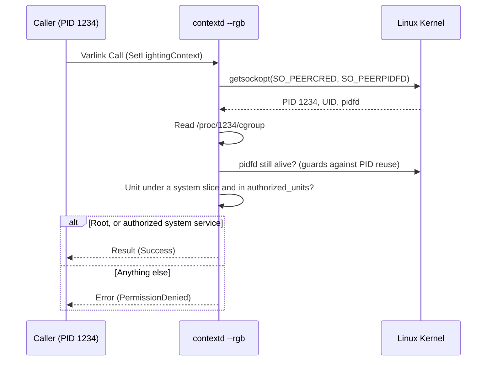

# Security Analysis & Access Control

`contextd` runs as a hardened system service and serves unprivileged user applications over Unix sockets. This document describes who can do what, and how that is enforced.

## 🔒 Who can do what

| Action | Socket | Enforced by |
| :--- | :--- | :--- |
| Read games, devices, diagnostics, hints | `public/contextd.socket` (0666) | Nothing: public |
| Register / remove a controller hint | `public/contextd.socket` | Caller credentials (`SO_PEERCRED`) |
| Read / subscribe to lighting | `public/contextd-rgb-observer.socket` (0666) | Nothing: public |
| Change lighting | `private/contextd-rgb-control.socket` (0660, `contextd-rgb`) | File permissions, then optional `auth.authorized_units` |

The sockets are created by systemd socket units (`packaging/*.socket`), so their mode and group are set before the daemon starts. When contextd is run by hand it binds them itself with the same modes, without a window in which they are more permissive.

### Lighting control

1. **File permissions** are the primary gate. Only root and members of the `contextd-rgb` group (created by `packaging/sysusers.d/contextd.conf`) can open the control socket. The OpenRGB bridge service joins that group.
2. **`auth.authorized_units`** optionally narrows access to specific system services:

Only units below a system slice (for example `/system.slice/openrgb.service`) are matched. Anything under `user.slice` is rejected, because users can create units with any name in their own session (`systemd-run --user --unit=openrgb ...`). With an empty list, every process that can open the socket may write.

### Controller hints

Hints are self-attested but bound to the caller:

- The hint's `pid` must be the calling process or one of its ancestors, owned by the same UID. `pid: 0` means "the caller", which sandboxed apps must use because their own PID differs from the one contextd sees.
- Only the owning UID, or root, can unregister a hint.
- Each hint records the process start time, so a hint disappears when its process exits even if the PID is reused.
- Field lengths, list sizes and the number of hints (32 per UID, 256 total) are capped.

### Configuration

`/etc/contextd/config.toml` is optional. If it exists and cannot be parsed, or contains an unknown key, contextd refuses to start: falling back to defaults would also silently drop any restrictions it configured.

## 🛡️ Resource limits

Each socket accepts at most 128 concurrent connections, and 16 per UID (`[server]` in the config). Idle connections are closed after 120 s, writes that stall for 10 s close the connection, and a single message is capped (64 KiB on the core socket, 2 MiB on the control socket for a full matrix). Lighting subscribers always receive the newest state; slow ones skip intermediate updates, and disconnected ones are reaped within a second.

The OpenRGB bridge listens on 127.0.0.1 only and rejects packets larger than 64 KiB.

## 🛠️ Service Hardening

The core daemon runs as a `DynamicUser` inside a **systemd portable service**. Inside the image, the only host paths it can see are the ones bind-mounted read-only in `contextd.service`. It holds two capabilities:

*   **CAP_SYS_PTRACE**: Required for reading `/proc/*/environ` to detect running games.
*   **CAP_DAC_READ_SEARCH**: Required for reading launcher manifests in users' home directories.

These exist only because a system service is reading per-user state, and they let the daemon read everything under `/home`. A per-user service would need neither; that change is tracked separately because it moves the socket paths. If the unit is ever used outside the portable image, `InaccessiblePaths=` hides `/etc/shadow`, SSH keys, `/root` and `/var/lib` as defence in depth.

The RGB daemon needs no capabilities, no network, and no access to `/home` or `/sys`.

### Isolation features (both daemons)
- `ProtectSystem=strict`, `ProtectHome=` (read-only for core, none for RGB), `PrivateTmp=yes`
- `PrivateNetwork=yes`, `RestrictAddressFamilies=`, `RestrictNamespaces=yes`
- `NoNewPrivileges=yes`, `MemoryDenyWriteExecute=yes`, `LockPersonality=yes`
- `SystemCallArchitectures=native`, `SystemCallFilter=@system-service`
